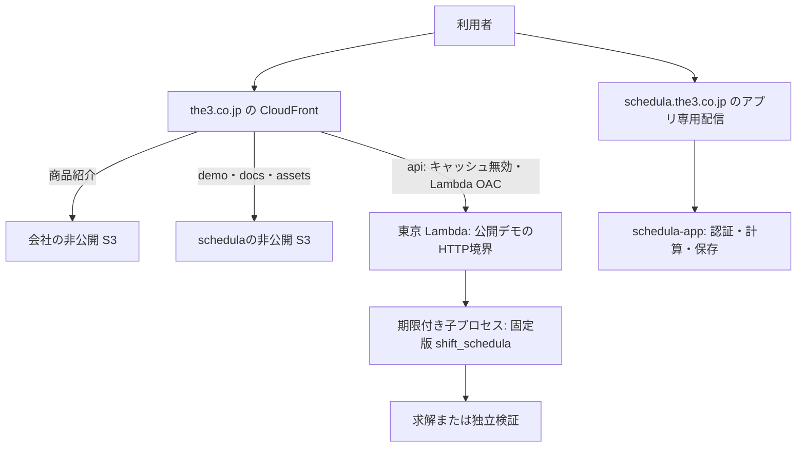

# 商品紹介・公開デモ・利用アプリの配信設計

状態: URL配置・責任分担を実装へ反映。コードとmock / ローカル検証はPRで確認する。AWS未適用。更新日: 2026-10-15（Asia/Tokyo）。公開・インフラ適用・運用開始の記録ではない。

読者は会社サイトと schedula の実装・運用担当者。読了後に、紹介文、デモ、顧客データをどこへ置き、どのリポジトリから公開するかを判断できることを目的とする。
中心の問いは「同じURL配下に商品情報を集めながら、各リポジトリで専用基盤を構築・更新する責任をどう保つか」である。

## 推奨する構成

商品紹介・公開デモ・技術案内を `https://the3.co.jp/products/schedula/` 配下へ集約する。
利用アプリ schedula-app の公開先は `https://schedula.the3.co.jp` とする。エンジン、デモ、利用アプリのソースと専用リソースは各リポジトリで管理する。

| 役割 | 推奨公開先 | ソース・公開責任 |
| --- | --- | --- |
| 会社の事業・製品への入口 | `https://the3.co.jp/` | `the3-inc/landing-page` |
| 製品一覧 | `https://the3.co.jp/products/` | 同リポジトリの `src/pages/products/index.astro` |
| schedula の商品紹介 | `https://the3.co.jp/products/schedula/` | 同リポジトリの `src/pages/products/schedula.astro` |
| 操作可能な公開デモ | `https://the3.co.jp/products/schedula/demo/` | `the3-inc/schedula` の画面・教材・公開用API・専用配信元 |
| 技術的な利用案内 | `https://the3.co.jp/products/schedula/docs/` | 同リポジトリの `demo/guide.html` と公開文書の許可リスト |
| 計算・独立検証API | `https://the3.co.jp/products/schedula/api/*` | 同リポジトリの公開用HTTP境界 |
| 顧客向け勤務計画アプリ | `https://schedula.the3.co.jp` | `the3-inc/schedula-app`。独自の配信・認証・保存・運用を管理する |

`schedula.the3.co.jp` は利用アプリ専用とし、公開デモや技術案内を置かない。DNS・CloudFront Aliasの既存利用状況は適用前に確認する。
ホスト名の決定だけで複数顧客の認証・データ分離まで成立したとは扱わない。現行アプリの顧客専用SQLiteを匿名デモと共用せず、複数顧客の収容方式はschedula-app側で決める。
公開URLは `/products/`、GitHub Environment・state・SSMの環境名は `production` を使う。

## 参照したソースと確認範囲

主要ソースは [landing-page PR #9](https://github.com/the3-inc/landing-page/pull/9) の固定head `f9f68cf14acfc3e85cd28c3d0830ac8bc8dfc041`。
取得時点ではopen・未マージで、base/mainは `cba4ff34cbdc27dd767749b81fb622d73640b9dc` だった。以下の参照はheadに固定する。

- [配信と公開手順](https://github.com/the3-inc/landing-page/blob/f9f68cf14acfc3e85cd28c3d0830ac8bc8dfc041/infra/README.md): foundation / company / 製品の所有境界、SSM契約、タグ公開、商品ページと製品の追加方法。
- [会社リソース定義](https://github.com/the3-inc/landing-page/blob/f9f68cf14acfc3e85cd28c3d0830ac8bc8dfc041/infra/company/main.tf)、[foundation定義](https://github.com/the3-inc/landing-page/blob/f9f68cf14acfc3e85cd28c3d0830ac8bc8dfc041/infra/foundation/main.tf)、[会社workflow](https://github.com/the3-inc/landing-page/blob/f9f68cf14acfc3e85cd28c3d0830ac8bc8dfc041/.github/workflows/deploy.yml): 実際の設定。
- [ディレクトリURLの解決](https://github.com/the3-inc/landing-page/blob/f9f68cf14acfc3e85cd28c3d0830ac8bc8dfc041/infra/company/directory-index.js): 静的ページの内部rewrite。
- schedulaは本checkoutの `205bc941dfab8f635065cbf60251a773e2c30ffd` を確認。[現行LP](landing-page.md)、[デモ仕様](playground.md)、[現行契約](io-contract-current.md)、[公開条件](development-policy.md#公開の条件)と照合した。
- schedula-appはローカルcheckoutの `ef1e55d3af342caf696b6c4f95e60b9811663a25` のREADMEを確認。React / FastAPI / 固定エンジン / 顧客専用SQLiteの構成を前提とする。[固定ソース](https://github.com/the3-inc/schedula-app/blob/ef1e55d3af342caf696b6c4f95e60b9811663a25/README.md)

PR #9は通常リージョンの東京移行、IDを含むOIDC信頼条件、S3 multipart uploadの後片付け権限を追加している。
会社と製品を分ける方針自体はbaseにもあり、PR #9が製品の実行環境を実装したわけではない。
固定headの[CI成功](https://github.com/the3-inc/landing-page/actions/runs/38718838320)はAWS認証なしのmock検証である。実AWS・DNS・Environment設定・稼働URLとの一致は確認していない。

PR #9の「製品ごとに専用CloudFrontを持ち、会社CloudFrontへOriginを追加しない」という方針は、今回の公開デモ・技術案内について変更する。
共有CloudFrontの所有元を会社側に保ち、専用の配信元を製品側で管理する。利用アプリの独立サブドメインにはPRの製品分離方針を適用する。

## Terraformの責任分担

**推奨は、専用リソースを各リポジトリで構築し、共有CloudFrontへの経路登録だけをlanding-pageに集約する方式である。**
全インフラをlanding-pageへ集めず、schedulaの `terraform plan / apply` と通常のデモ公開はschedula内で行う。
共有の入口への初回登録・経路変更・配信元の置換では会社側のplan / applyも必要になる。この共有部分まで完全に一つの製品リポジトリ内で閉じることは目標に含めない。

### CloudFrontを一つのstateで管理する理由

参照PRの `aws_cloudfront_distribution.site` はOriginやBehaviorを内部ブロックとして管理する。
AWSの更新APIもDistribution設定全体を置き換え、変更部分だけを既存設定へマージする動作ではない。
同じDistributionをschedulaのstateへimportしたり、別stateからOriginだけを変更したりすると、会社側の次のapplyと競合する。
`local-exec` やAWS CLIで設定を追加し、Terraformの管理外に差分を残す方式も採用しない。[AWSの更新仕様](https://docs.aws.amazon.com/cloudfront/latest/APIReference/API_UpdateDistribution.html)

| 選択肢 | リポジトリ内での完結性 | 判断 |
| --- | --- | --- |
| すべてlanding-pageで構築 | 製品のLambdaやIAM変更も会社側へ依頼する | 製品の責任が離れるため採用しない |
| 各repoのstateから同じCloudFrontへ追加 | 見かけ上は製品だけで変更できる | 同一リソースの二重管理になるため採用しない |
| 専用基盤は各repo、共有経路は会社側 | 通常更新は各repo、接続変更は会社側と連携する | 推奨 |

| 所有元 | 管理するもの | 製品追加で行うこと |
| --- | --- | --- |
| `landing-page/infra/foundation` | 共通GitHub OIDC providerとSSM契約 | 既存契約を読む。製品から共通リソースを再作成しない |
| `landing-page/infra/company` | 会社S3・共有CloudFrontの全Origin / Behavior・OAC・配信ポリシー・WAF・ACM・apex DNS・会社公開ロール | schedulaの配信元とパスを登録する |
| `schedula/infra/demo`（新設案） | デモS3とbucket policy・Lambdaと呼出し許可・ECR・公開ロール・ログ・製品側SSM契約 | 製品用の別stateで管理し、会社Distributionを変更しない |
| `schedula-app/infra/`（配置案） | アプリの配信元・独自CloudFront・ACM・`schedula.the3.co.jp` のDNS・認証・保存・運用 | アプリ専用stateで管理する |

デモ用のDNS・証明書・独自Distributionは作らない。会社rootを製品用backendで実行することも避ける。
会社は経路・OACを所有し、デモは自身のbucket policyとLambda resource policyで会社Distributionからのアクセスだけを許可する。両側で同じpolicyを管理しない。

### landing-pageのTerraformを参照する方法

Terraform moduleの参照は定義の再利用であり、配布元の実リソースに対する追加操作にはならない。
landing-pageのroot自体をschedulaからmoduleとして呼ぶと、会社用リソースも製品stateで作成・管理することになるため使わない。
会社の実リソースへの接続には次節のSSM契約を使う。[moduleの構成と依存の渡し方](https://developer.hashicorp.com/terraform/language/modules/develop/composition)

再利用する定義が生じた場合はlanding-pageの `infra/modules/` に、backendや会社Distributionを所有しないchild moduleを切り出せる。
schedula側はそのsubdirectoryをGit sourceの固定commit SHAで参照し、自身のroot・backend・tfvars・provider lock・workflowを保持する。
新moduleは参照先のPR #9には存在しない。初回はSSM契約と会社側の明示的な経路定義を追加し、module化は実際に重複する定義が出てから行う。
固定refを更新しない限り利用側へ自動反映せず、同じmoduleを使っても同一AWSリソースを複数stateへ登録しない。[module source](https://developer.hashicorp.com/terraform/language/modules/sources)

### stateを読まずに接続する契約

既存foundationの東京SSM `String` 3値はそのまま利用する。

```text
/the3/production/foundation/v1/aws-account-id
/the3/production/foundation/v1/hosted-zone-id
/the3/production/foundation/v1/github-oidc-provider-arn
```

この3値の意味を変更せず、今回必要な接続情報を別のバージョン付きパスへ追加する。以下の2契約を実装する。AWSには未適用である。

| SSMパス（東京・String内のJSON） | 所有・書込元 | 読取元 | 公開する非機密値 |
| --- | --- | --- | --- |
| `/the3/production/company/v1/edge` | company root | schedulaのIaC | `schema_version`、`aws_account_id`、`host`、`distribution_arn` |
| `/the3/production/products/schedula/v1/origins` | schedula root | companyのIaC | `schema_version`、`aws_account_id`、`region`、`static_origin_domain`、`function_url_domain`、`function_alias_arn` |

最初の契約は `host=the3.co.jp` と会社DistributionのARNを渡す。デモ側はそのARNをS3 / Lambdaの `AWS:SourceArn` 制限に使う。
次の契約は登録対象のS3 regional domainと固定alias `live` のFunction URL domain等を渡す。URLのschemeやpathはdomainへ含めない。
会社側は登録するSSMパスと許可する公開パスを明示する。製品がSSMを書いたことだけでは会社CloudFrontへ自動登録されない。
契約のschema・想定account・host・region・S3 / LambdaのdomainとARNの整合を検証し、差分を会社側のplanで確認してからapplyする。

各IaC実行主体へ必要なSSMパスの `GetParameter` だけを許可し、所有する契約だけに書込権限を与える。
通常公開ロールはSSM・他repoのstate・会社のS3 / IAM / DNS / CloudFront設定へアクセスしない。
`terraform_remote_state` は使わない。公開値の参照のためにstate全体へのアクセスを渡さない。[HashiCorpのデータ共有指針](https://developer.hashicorp.com/terraform/language/state/remote-state-data)

デモstateのkey案は `production/schedula-demo/terraform.tfstate`、アプリ側は `production/schedula-app/terraform.tfstate`。
暗号化・非公開・バージョニング・TLS・native lockを持つbackendを使い、自keyとlockに権限を限定する。
既存stateがある場合は所在地を調べ、空のkeyへの切替やリージョン移行とは別作業にする。
Terraform / providerは参照PRの固定版とprovider lockを出発点とし、module化や所有権の変更にバージョン更新を混ぜない。

### 初回構築と接続の順序

1. foundationとcompanyを用意し、製品経路がない状態で会社Distributionと `company/v1/edge` を公開する。
2. schedulaで会社契約を読み、ECR作成・初期イメージ投入、S3・Lambda・アクセス許可を構築して `products/schedula/v1/origins` を公開する。
3. 会社側でschedulaの登録を有効化し、契約を読み込んでOrigin・Behavior・OAC・パス限定WAFルールを追加する。
4. schedulaのWeb成果物を配備し、公開URLで検証した後に会社の商品紹介・一覧から案内する。

会社rootは未登録製品のSSMを必須参照しない。明示的な登録フラグでデータ参照を有効化し、契約ができるまで会社の初回planを妨げない。
以後の画面・教材・Lambda version更新ではOrigin domainを変えず、schedulaの公開だけで完結させる。
配信元を置換してdomainが変わる場合は、新旧を併存させて会社側の切替・検証後に旧配信元を削除する。廃止時は会社側の経路・案内を先に解除する。

## 公開デモの実行構成



**会社の共有CloudFront + デモ専用の非公開S3 / Lambdaコンテナー**を推奨する。静的画面には既存HTML / CSS / JavaScriptを使い、デモのためにReactやAstroへ書き直さない。
Python 3.14系とOR-Toolsを含むLinux `x86_64` イメージを固定digestで配備する。Pythonの固定パッチ版とnative依存は実イメージ内で検証する。
Lambda Runtime Interface Clientを持つ薄いHTTP境界から公開APIを呼び、独立したエンジンサービスは作らない。
Lambdaのコンテナー要件は[公式資料](https://docs.aws.amazon.com/lambda/latest/dg/images-create.html)を参照する。

現在の [demo/server.py](../demo/server.py) はloopback固定、localhostのHost/Origin検査、同時1件のlockを持つ試用サーバーである。
bind先やHost検査を緩めて公開せず、公開用HTTP境界を別に置く。契約・厳密JSON読取・求解・独立検証は既存APIを再利用する。
デモ画面・教材・公開用APIは同じcommitからビルドし、`docs/reference/`、テスト結果、Git情報、顧客データは配信成果物へ含めない。

### URLとキャッシュ

| 経路 | 配信・処理 | 条件 |
| --- | --- | --- |
| `/products/schedula/` | 会社S3 | 商品紹介。既存の会社用default Behaviorで配信 |
| `/products/schedula/demo`、`/products/schedula/docs` | 末尾 `/` へ308 | 各パスの静的Behaviorへ専用Functionを関連付ける |
| `/products/schedula/demo/` とその配下 | デモS3 | 画面と公開教材。キャッシュ無効 |
| `/products/schedula/docs/` とその配下 | デモS3 | 案内と現行4文書の許可リスト。キャッシュ無効 |
| `/products/schedula/assets/*` | デモS3 | 内容hashを含むJS / CSS等。長期キャッシュ・過去版保持 |
| `/products/schedula/license.txt` | デモS3 | ライセンス。キャッシュ無効 |
| `/products/schedula/api`、`/products/schedula/api/*` | Lambda | API専用Behavior、キャッシュ無効、必要なheaderを転送 |

会社rootがS3 / Lambda用Originを2つ追加する。`/products/schedula/*` を一括で別Originへ流さず、上表の用途別Behaviorを明示する。
`demo` / `docs` は末尾なしのexact matchと `demo/*` / `docs/*` を定義し、APIやassetsと重複しない順序をテストする。`/products/schedula/api` 自体はAPI側で404にする。
静的S3は公開URLと同じキー、例えば `products/schedula/demo/index.html` に配置する。Origin pathは空にし、prefixを二重に追加しない。
デモ公開ロールのS3オブジェクト権限は `products/schedula/` に限定する。会社サイトの同期・削除対象は会社S3だけとする。
静的Functionは末尾 `/` に `index.html` を補い、APIには付けない。API handlerは `/products/schedula/api/solve-json` と `/products/schedula/api/verify-json` を直接受ける。
[CloudFrontのパス選択](https://docs.aws.amazon.com/AmazonCloudFront/latest/DeveloperGuide/DownloadDistValuesCacheBehavior.html)、[Origin設定](https://docs.aws.amazon.com/AmazonCloudFront/latest/DeveloperGuide/DownloadDistValuesOrigin.html)

HTML・教材・文書・APIに `CachingDisabled` を使い、応答の `Cache-Control` も `no-store` とする。hash付きassetsだけ長期キャッシュする。
通常のデモ公開に会社Distributionの無効化権限を渡さず、API aliasとS3の更新だけで反映する。会社の既存 `/*` 無効化はデモにも影響するが、デモのS3を書き換えることはない。
[AWSのキャッシュポリシー](https://docs.aws.amazon.com/AmazonCloudFront/latest/DeveloperGuide/using-managed-cache-policies.html)
CloudFrontのメソッド設定ではPOSTを含む選択肢を使い、アプリでPOST以外を拒否する。静的配信はGET / HEADに限定する。
APIを含むエラーのHTMLへの変換や、全URLを `/index.html` へ返すSPA fallbackは作らない。
PRのFunctionは内部rewriteだけであり、canonical redirectや独自404の実装ではない。デモでは上記転送を明示し、不存在の静的キーの403/404を実環境で確認する。APIの未知経路は404を返す。

### APIの到達制限

Function URLは `AWS_IAM`、会社rootが作るLambda用OACは `always` とする。schedula rootのresource policyで会社Distributionだけに `lambda:InvokeFunctionUrl` と `lambda:InvokeFunction` を許可する。
Function URLは固定alias `live` に紐付け、CloudFrontのOriginとInvoke権限もそのaliasを対象にする。無修飾の `$LATEST` を公開先にしない。
URL直アクセスは拒否する。公開ブラウザーにAWS資格情報は持たせない。
POSTには本文のSHA-256が必要なので、送信するUTF-8本文そのものから `x-amz-content-sha256` を生成し、CloudFrontから転送する。
本文をhash計算後に再生成しない。既存の送信処理を小さな共通処理に揃える。[Lambda OACの公式要件](https://docs.aws.amazon.com/AmazonCloudFront/latest/DeveloperGuide/private-content-restricting-access-to-lambda.html)

会社ページからは通常リンクでデモへ移動し、紹介・デモ・技術案内・APIは同一オリジンにする。CORSのワイルドカードは不要。
公開APIは想定HostとOriginを検査し、ブラウザーからの想定外Originを拒否する。Origin向けHostはFunction URLのホストを使い、viewerのHostをそのまま転送しない。
Originは利用者認証にならないため、負荷制御も別に実施する。
公開デモにログイン・Cookie・DBを追加しない。同一オリジンのJavaScriptは会社ページと同じ信頼境界になるため、利用者が入力したHTMLや任意スクリプトを配信しない。
schedula-appのセッションは `schedula.the3.co.jp` のhost-only Cookieとし、`Domain=the3.co.jp` で共有しない。Secure・HttpOnly等と、アプリOriginの検査・CSRF対策はアプリ側で管理する。
保存先や認証をURLのpathだけで分離したとは扱わない。

### 公開する教材と実行上限

初回の公開対象として、現在のLPが案内している **必要人数・連勤・手修正検証の3教材**を実装する。
選定理由は紹介内容との一致と、サーバーが固定入力・編集範囲を検証できる小さな問題であること。他の実装済み教材は、同じ公開条件を確認して追加できる。
自由JSON、100人・30日、入力アダプター・実行記録の入出力はローカル試用に残す。公開画面からこれらの操作・通信・未公開教材へのリンクを除き、APIでも拒否する。
既存の11分待機をそのまま公開HTTPの要件にはしない。[現行デモの範囲](playground.md)

| 対象 | 初期設定案・受入条件 |
| --- | --- |
| 入力 | UTF-8 JSON、本文64 KiB以下。重複キー・非有限数・未知項目を拒否する |
| 編集 | 教材IDをheaderで明示し、サーバー側の固定教材と許可フィールド・値域を比較する。IDだけで入力を信頼しない |
| 問題規模 | 登録済み教材の人数・日数・候補・目的を固定。候補展開を増幅する未知テンプレートを受け付けない |
| 計算 | 教材の探索予算5秒を保持。子プロセス全体20秒、Lambda 30秒、CloudFront応答35秒、画面待機40秒を上限の提案値とする |
| メモリ・並行数 | Lambda 2,048 MB、reserved concurrency 2を測定の開始値にする。子プロセスは必ず終了・回収し、呼出し間で入力・結果を共有しない |
| 混雑・失敗 | 超過・throttle・期限・内部障害を画面で区別し、自動再送しない。通信失敗を `INFEASIBLE` と表示しない |
| 応答 | エラーと結果はキャッシュしない。結果本文は1 MiB以内を検査し、超過はエラーにする |
| データ | 架空教材のみ。Request・Response・従業員名をログやS3へ保存しない。処理後は参照と一時ファイルを解放する |

これは実測済みの性能保証ではない。cold start・候補展開・結果検証を含め、最悪の許可編集で上限内に収まることを公開条件にする。
探索予算と総応答期限を区別し、ブラウザーのabortだけで計算停止したとは扱わない。期限切れでは子プロセスを終了し、エンジンの有効なResponseを捏造しない。
`PARTIAL` は不足のある計画、独立検証成功は完全充足とは別、手修正検証は探索・最適性証明なしという意味を維持する。

会社側が共有CloudFrontのWAFを所有し、`/products/schedula/api/` にscopeを限定したIP単位と全体のrate制限を置く。最初はIPごと60回/5分・全体300回/5分を提案値とし、連続操作と共有IPの試験で調整する。
同時数上限とrate制限は費用の絶対上限ではない。WAF・ログの料金も含めて見積もり、エラー率・throttle・期限超過・費用の通知先を設定する。
異常時はschedula側でLambdaのreserved concurrencyを0へ落とせる手順を残す。会社側ではAPIパスだけを遮断できるようにする。
ログはメタデータ中心で保持14日を案とし、WAFログ等にも本文を含めない。
[Lambdaの実行上限](https://docs.aws.amazon.com/lambda/latest/dg/gettingstarted-limits.html)、[同時実行数の制御](https://docs.aws.amazon.com/lambda/latest/dg/configuration-concurrency.html)

長時間の任意入力や顧客データを扱う必要が生じた場合は、ジョブ方式または顧客向けコンテナー実行基盤を別途設計する。
今回の用途に常駐ECS / ALB / DB / キューは追加しない。App Runnerは新規顧客を受け付けていないため、新規構成の前提にしない。[AWSの案内](https://docs.aws.amazon.com/apprunner/latest/dg/apprunner-availability-change.html)

## ソース配置と商品ページ

実装の配置は次のとおり。landing-pageとschedulaの変更をPRで確認し、schedula-appは公開先と責任分担だけを定める。

```text
landing-page/
  src/pages/products/index.astro       製品一覧
  src/pages/products/schedula.astro    商品紹介の正本
  public/                             紹介画像
  tests/site.test.ts                  紹介内容・リンク・共通レイアウト
  .github/workflows/deploy.yml        公開URL検証へ2ページを追加
  infra/company/                     共有CloudFrontのOrigin / Behaviorと接続契約

schedula/
  demo/                               既存画面・ローカル確認用LP
  examples/playground/                 教材の正本
  web/                                公開用HTTP境界・コンテナー定義
  infra/demo/                         製品用Terraform root・mockテスト
  scripts/                            許可リストによる静的成果物生成
  .github/workflows/deploy-demo.yml    Web公開専用workflow

schedula-app/
  infra/                              アプリ専用基盤・state・サブドメインDNS
```

`/products/` は製品名・対象業務・短い価値説明・「詳細を見る」の最小一覧にする。1製品でも会社トップから製品へ進む入口として置く。
`/products/schedula/` は、現在の [demo/landing.html](../demo/landing.html) の内容を会社の `SiteLayout.astro` とスタイルへ移植する。
会社ページの `site=https://the3.co.jp` と `base=/` はそのまま使い、追加ページのcanonicalを会社URLにする。

商品ページの構成は「対象となる困り事 → 担当配置・勤務計画でできること → 3教材へのリンク → 自力利用と導入・開発支援の区分 → 利用案内 → 相談」とする。
PyPI公開・ソース公開・SLA・実績は確認済みの状態だけを書く。相談は既存の `omitsuhashi@the3-o.com` へのmailtoを継承し、会社の連絡先ページとも整合させる。
会社の紹介ページでは計算せず、デモ3教材へ通常リンクする。iframe埋め込みや会社向けの計算APIは作らない。

`demo/landing.html` はローカル試用のため残せるが、公開紹介の更新元は会社サイトへ移す。文言を両リポジトリへ同期する仕組みは作らない。
公開ビルドでは共通baseを `/products/schedula/`、API baseを `/products/schedula/api/` とする。
`index.html` / `guide.html` のリンク、全JSのfetch、サンプル、CSS内URL、ライセンス、フォーム送信先、canonicalと戻り先を同時に変更する。
公開用に `guide.html` を `products/schedula/docs/index.html` として出力し、LPを複製せず、必要な `landing.css` 等をhash付きassetsとして配信する。
Markdown本文は現行4文書だけを `docs/` 配下へ出力し、相対リンク・参照先の公開可否を利用者の立場で点検する。
公開ページのどの操作も `/demo/`・`/docs.html`・`/landing.css`・旧APIへ通信しないことを検査する。

ローカルは現行の `/`・`/demo/`・`/docs.html` と `/demo/solve-json` 等を維持する。小さな公開用build設定でURL差分を扱い、エンジンや教材を複製しない。
この構成は [LPの配信設計](landing-page.md) にあるローカル経路を公開ホストのルートへそのまま置く案と、本書の旧サブドメイン案を置き換える。
`schedula.the3.co.jp/demo/` を公開済みという前提は置かず、デモ用DNSや旧URLの転送を新設しない。実在する旧公開URLが見つかった場合に移行を追加する。

## 公開とインフラ変更

### 公開単位とタグ

会社紹介の更新はlanding-pageの `vMAJOR.MINOR.PATCH`、schedulaのWeb公開は **`web-vMAJOR.MINOR.PATCH`** を使う。
既存 [.github/workflows/publish.yml](https://github.com/the3-inc/schedula/blob/205bc941dfab8f635065cbf60251a773e2c30ffd/.github/workflows/publish.yml) は `v*` タグでPyPI公開を開始するため、Web更新に同じタグを流用しない。
Web公開のためだけにPythonパッケージ版を変更せず、記録にはWebタグ・commit・パッケージ版・JSON契約版・イメージdigest・静的成果物のSHAを残す。

PR #9の方式に合わせ、インフラは管理用認証の `plan → show → 明示的apply`、公開workflowは既存リソースへの配備だけとする。
デモS3・ECR・LambdaとSSMは東京。公開デモには会社のDistributionと証明書を使い、専用DNS / ACMを作らない。会社の公開ロールをデモ公開に流用しない。
schedula-appは自身のrootで `schedula.the3.co.jp` のDistribution・DNS・配信元を管理する。CloudFront用ACM発行・検証は `us-east-1` とし、会社の証明書を共有しない。

初回はECR作成・初期イメージ投入を先に行い、そのdigestでLambdaを含む残りのリソースを構築する。初期投入は管理用認証で行い、通常のタグ公開へ常設のインフラ権限を渡さない。
Lambdaコードと公開aliasの参照先はschedulaの公開workflow、実行設定・URL・権限はschedulaのTerraform、OACと接続設定は会社のTerraformが所有する。
通常planが公開済みコードを初期digestへ戻さないよう、コード・alias参照先の差分をIaCの更新対象から除外する。
固定alias `live` の向け先だけを新versionへ更新し、Function URLとCloudFrontのOriginは公開のたびに変更しない。[Function URLとaliasの関係](https://docs.aws.amazon.com/lambda/latest/dg/urls-configuration.html)
デモの初回経路追加からコンテンツ配置・API検証完了まで未準備の時間があることを手順に含める。アプリでは別途DNS作成後の初回公開を検証する。

### GitHub認証と権限

Web公開はschedulaリポジトリの `production` Environmentを使い、既存のPyPI用 `pypi` と区別する。
`main` のPR・`quality-checks`、`web-v*` の作成者制限・移動/削除禁止、productionの許可refを設定する。
手動切り戻し用の `main` と公開用 `web-v*` を許可し、required reviewersの有無は運用責任者・利用プランに合わせて設定する。

OIDCの `aud=sts.amazonaws.com` と、schedulaの実 `sub_claim_prefix` に `:environment:production` を付けたsubjectを完全一致で検査する。
ID付きsubjectを確認して使い、会社リポジトリのsubjectはコピーしない。Environmentのsubjectにはrefが含まれないため、GitHub側のref制限も必要である。
IaC outputsをEnvironment variablesへ渡し、公開workflowにはstateや共通SSMの読取権限を与えない。

| ロール | 更新できる範囲 |
| --- | --- |
| 会社のIaC管理主体 | 会社のインフラ・state、共有CloudFrontとOAC / WAF、会社契約の書込、登録した製品契約の読取 |
| デモのIaC管理主体 | デモのインフラ・専用stateとlock、foundation / 会社契約の読取、自製品の契約とOrigin policyの管理 |
| デモ公開ロール | デモ用S3の配置・削除・multipart cleanup、専用ECRへのpush、自己Lambdaのコード・version・alias操作。会社CloudFrontの変更・無効化は許可しない |
| Lambda実行ロール | 自身の必要なログ出力のみ。会社・顧客データ・stateへのアクセスなし |

通常公開ロールからIAM / DNS / OAC / SSM / インフラ設定を変更できないようにする。
デモ公開ロールのリソースARNを自製品へ限定し、ECR認証token等でワイルドカードが必須な操作は必要なものだけ個別に記す。

### 配備・確認・切り戻し

Webタグの形式・mainへの包含・該当commitの `quality-checks` 成功を確認し、同じcommitから静的成果物とコンテナーを作る。
製品用concurrencyで公開を直列化し、APIのversion公開・alias更新、hash付き静的資産・HTML配置を行う。デモ公開ではCloudFront無効化を行わない。
キャッシュ無効のHTML・文書・教材は配備後の新規リクエストで更新を確認する。hash付き旧資産は保持し、開いている画面の参照を壊さない。
前後の画面/APIが混在する時間を考慮して同じ契約の互換性を保つ。非互換なHTTP変更はメンテナンスを挟むか別経路へ移行する。
現行会社workflowと同じファイル単位の配備では、画面とAPIの同時・原子的切替は保証できない。

完了は公開画面・資産・実計算・独立検証・直接Originの拒否を確認した後に記録する。HTTP 200だけでは完了としない。
成功した製品URLを確認してから、会社の紹介ページと製品一覧を会社タグで公開する。会社側の公開URL検証にも2ページを加える。
会社タグでデモを再ビルドせず、デモタグで会社S3を更新しない。経路変更時には会社の `/`・`/company/`・`/contact/`・商品紹介の回帰も確認する。

切り戻しは会社紹介とデモで独立して行い、既存タグを移動・再作成しない。
デモは直前のLambda version / image digestと対応する静的成果物を記録・保持し、一組で復元する。保持期限内の公開版に絞り、ログ・S3旧版・ECRイメージの削除方針を定める。
公開workflowを手動実行するコードはmain側の検証済み定義とし、復元対象の旧版から任意のworkflowを実行しない。
再ビルドだけで切り戻す場合は、同一バイト復元を保証できないことを記録する。
会社のTerraformをschedula登録前へ戻すとデモと技術案内の経路が失われる。会社のコンテンツ切り戻しとインフラの切り戻しは区別する。

### schedula-appの公開境界

`https://schedula.the3.co.jp` は保存・再開・顧客データを扱うアプリの入口とする。
アプリ側リポジトリが専用のDistribution・配信元・ACM・DNS・デプロイロール・stateを持ち、foundationのゾーン / OIDC契約を利用する。
公開デモのLambda、S3、実行記録、Cookie、顧客のSQLiteを共用しない。データをS3の静的公開領域へ置かない。
現行のローカル用FastAPIをそのまま匿名公開せず、アプリ側で認証・許可Origin・永続保存・バックアップ復元・更新手順を設計する。
単一顧客の専用運用か、複数顧客を分離した運用かはアプリ側の判断事項であり、この文書更新では保存モデルを変更しない。

## 実装範囲と受入条件

| 作業単位 | 変更が届く箇所 | 確認すること |
| --- | --- | --- |
| 会社の商品紹介・一覧 | 会社の2ページ、ナビゲーション、画像、content test、公開URL確認 | 同一prefixのデモ・技術案内・相談への遷移、canonical、共通レイアウト |
| 会社の経路登録 | companyのOrigin / Behavior・OAC・cache / header policy・WAF・SSM入出力・mockテスト | 会社ページを別Originへ流さないこと、prefix二重付与なし、APIのrewriteなし、単一stateの所有 |
| schedulaの専用基盤 | `infra/demo/` のS3 / Lambda / ECR / role / ログ・SSM入出力・Origin policy・lock | 会社Distribution限定の到達、契約不整合の拒否、会社CloudFront / DNS / stateを変更できないこと |
| 公開画面・技術案内 | `index.html`、全JS/CSS、教材一覧、`guide.html`、Markdown、静的build | 3教材へ到達、base / API / fetch / canonical / assetsの対応、公開対象外・旧ルートへの通信なし |
| API境界 | Lambda handler、送信本文hash、教材の固定値/値域検査、子プロセス期限 | 新prefixでPOST署名・独立検証、不正入力・異常Origin拒否、kill/reap、本文をログへ出さないこと |
| 公開・切り戻し | schedulaのWebタグworkflow、Environment、Rulesets、成果物記録 | PyPIが起動しないこと、CloudFront無効化権限なしで反映すること、旧画面/APIの復元 |
| schedula-app | アプリ用DNS / ACM / Distribution / 配信元 / 認証 / 永続保存 | 正式ホストから認証して保存・再開、デモとのデータ・Cookie分離、バックアップ復元 |
| ローカル利用・配布 | 既存server、ローカルLP、公開デモと共用する資産・教材、配布テスト | ローカルの自由JSON・100人30日・Adapter等を壊さないこと、機密資料が静的成果物へ入らないこと |

実装時は、変更した共用部分に対応する既存Python / HTTP / distribution / Chromium検証を実行し、公開APIの境界テストを追加する。
実ブラウザーでは必要人数変更による不足、連勤制限、手修正後の違反表示を実エンジンで確認する。モバイル・キーボード・遅延応答の失効も維持する。
AWSの測定は固定digest・cold/warm・許可編集の端点・混雑時を含め、総時間・メモリ・状態・検証結果を記録する。
Terraformのmockでは契約欠落・他account・誤domain・未登録製品を検査し、会社rootの初回planに製品契約を要求しないことも確認する。
共有CloudFrontの変更は会社・製品のHTTP / ブラウザー回帰を通し、通常のデモ更新で会社側applyが不要なことを確認する。

## 適用前に残る確認

- PR #9の採用commitと、foundation / companyの実state・東京SSM契約の適用状況。会社側の旧「Originを追加しない」方針・README・mockテストも更新する。
- 追加SSM契約のschema・パス・書込主体と、会社側の明示的登録。未適用の新契約を既存と混同しない。
- schedula-app用 `schedula.the3.co.jp` の既存DNS / Alias / 証明書の所有者、NS委任、認証・保存・顧客分離方式。
- 実際のOIDC subject、Environment variables・保護、Lambda quota、対応LinuxイメージのPython / OR-Tools動作。
- 3教材から始める公開範囲、測定に基づく時間・メモリ・rate制限、費用と障害の連絡先。数値は本書では提案値である。
- 紹介文の提供範囲、ソース・PyPIの実公開状況、問い合わせ先と技術文書の公開リンク。
- 共有CloudFront・同一オリジンによる変更と障害の影響。会社側の経路・WAF誤設定は会社とデモの両方へ影響し得る。

実装とAWS認証なしの検証手順は[デモ基盤のREADME](../infra/demo/README.md)を参照する。landing-page側にも経路登録とSSM契約を実装する。AWS / GitHub設定、実デプロイ、公開性能・費用の検証は実施していない。schedula-appの実装は今回の範囲に含めない。
