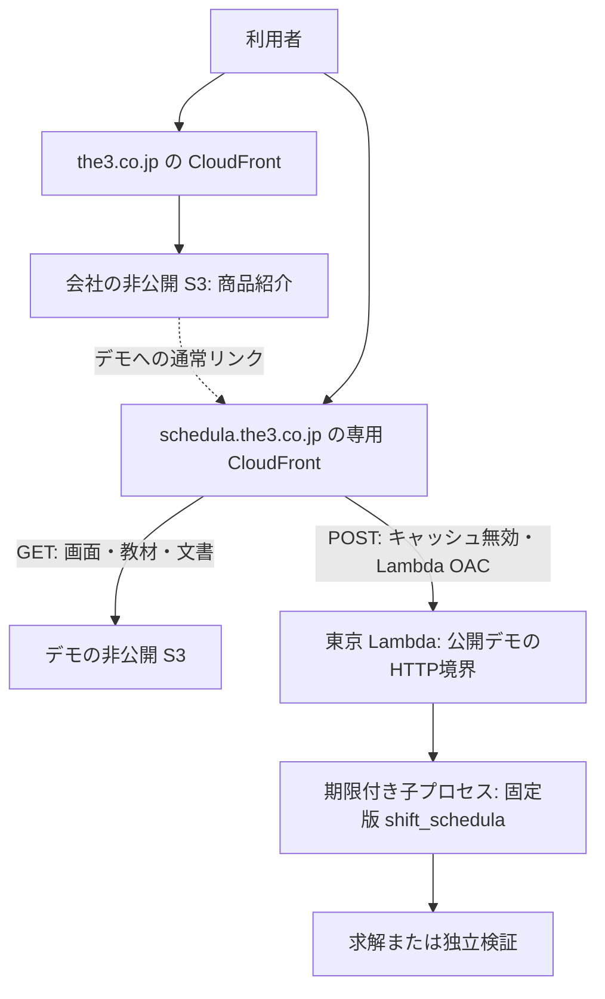

# 商品紹介・公開デモ・利用アプリの配信設計

状態: 提案。調査日: 2026-10-15（Asia/Tokyo）。本書は構成を選ぶための設計であり、公開・インフラ適用・運用開始の記録ではない。

読者は会社サイトと schedula の実装・運用担当者。読了後に、紹介文、デモ、顧客データをどこへ置き、どのリポジトリから公開するかを判断できることを目的とする。
中心の問いは「会社サイトの公開方式を引き継ぎながら、計算負荷や顧客データを会社サイトからどう分離するか」である。

## 推奨する構成

会社サイトに商品紹介を集め、操作可能なデモは製品専用サブドメインへ置く。顧客向けの schedula-app は顧客ごとの配置・保存を維持する。
紹介文の正本は会社サイトに一つ置き、エンジン、デモ、利用アプリのソースをそれぞれの所有元に残す。

| 役割 | 推奨公開先 | ソース・公開責任 |
| --- | --- | --- |
| 会社の事業・製品への入口 | `https://the3.co.jp/` | `the3-inc/landing-page` |
| 製品一覧 | `https://the3.co.jp/products/` | 同リポジトリの `src/pages/products/index.astro` |
| schedula の商品紹介 | `https://the3.co.jp/products/schedula/` | 同リポジトリの `src/pages/products/schedula.astro` |
| 操作可能な公開デモ | `https://schedula.the3.co.jp/demo/` | `the3-inc/schedula` の画面・教材・公開用API・専用インフラ |
| 技術的な利用案内 | `https://schedula.the3.co.jp/docs.html` | 同リポジトリの `demo/guide.html` と公開文書の許可リスト |
| 顧客向け勤務計画アプリ | 顧客ごとの専用配置 | `the3-inc/schedula-app`。公開デモのAPIや保存先を共用しない |

サブドメインは推奨名であり、既存DNS・CloudFront Aliasの空きは未確認。最初はデモ用として使い、将来の利用アプリの公開ホストは独立して決める。
ご指定の `productions/` に相当する経路は参照先に存在せず、PRの表記は **`/products/`** である。本案は商品紹介の意図として扱う。
`production` はGitHub Environment・state・SSMの環境名として使う。

## 参照したソースと確認範囲

主要ソースは [landing-page PR #9](https://github.com/the3-inc/landing-page/pull/9) の固定head `f9f68cf14acfc3e85cd28c3d0830ac8bc8dfc041`。
取得時点ではopen・未マージで、base/mainは `cba4ff34cbdc27dd767749b81fb622d73640b9dc` だった。以下の参照はheadに固定する。

- [配信と公開手順](https://github.com/the3-inc/landing-page/blob/f9f68cf14acfc3e85cd28c3d0830ac8bc8dfc041/infra/README.md): foundation / company / 製品の所有境界、SSM契約、タグ公開、商品ページと製品の追加方法。
- [会社リソース定義](https://github.com/the3-inc/landing-page/blob/f9f68cf14acfc3e85cd28c3d0830ac8bc8dfc041/infra/company/main.tf)、[foundation定義](https://github.com/the3-inc/landing-page/blob/f9f68cf14acfc3e85cd28c3d0830ac8bc8dfc041/infra/foundation/main.tf)、[会社workflow](https://github.com/the3-inc/landing-page/blob/f9f68cf14acfc3e85cd28c3d0830ac8bc8dfc041/.github/workflows/deploy.yml): 実際の設定。
- [ディレクトリURLの解決](https://github.com/the3-inc/landing-page/blob/f9f68cf14acfc3e85cd28c3d0830ac8bc8dfc041/infra/company/directory-index.js): 静的ページの内部rewrite。
- schedulaは本checkoutの `205bc941dfab8f635065cbf60251a773e2c30ffd` を確認。[現行LP](landing-page.md)、[デモ仕様](playground.md)、[現行契約](io-contract-current.md)、[公開条件](development-policy.md#公開の条件)と照合した。
- schedula-appはローカルcheckoutの `ef1e55d3af342caf696b6c4f95e60b9811663a25` のREADMEを確認。React / FastAPI / 固定エンジン / 顧客専用SQLiteの構成を前提とする。[固定ソース](https://github.com/the3-inc/schedula-app/blob/ef1e55d3af342caf696b6c4f95e60b9811663a25/README.md)

PR #9は通常リージョンの東京移行、IDを含むOIDC信頼条件、S3 multipart uploadの後片付け権限を追加している。
会社と製品を分ける方針自体はbaseにもあり、PR #9が製品の実行環境を実装したわけではない。
固定headの[CI成功](https://github.com/the3-inc/landing-page/actions/runs/38718838320)はAWS認証なしのmock検証である。実AWS・DNS・Environment設定・稼働URLとの一致は確認していない。

## 引き継ぐ配信・管理の境界

| 所有元 | 管理するもの | 製品追加で行うこと |
| --- | --- | --- |
| `landing-page/infra/foundation` | 共通GitHub OIDC providerとSSM契約 | 既存契約を読む。製品から共通リソースを再作成しない |
| `landing-page/infra/company` | 会社用のS3・CloudFront・ACM・apex DNS・公開ロール | 紹介ページを静的ビルドに追加する |
| `schedula/infra/demo`（新設案） | デモ専用S3・CloudFront・Lambda・ECR・ACM・サブドメインDNS・公開ロール・ログ | 製品用の別stateで管理する |
| `schedula-app` | 顧客の入力・保存・アクセス・運用 | 現行の顧客別配置の責任を維持する |

根拠はPRの[管理境界と製品の追加契約](https://github.com/the3-inc/landing-page/blob/f9f68cf14acfc3e85cd28c3d0830ac8bc8dfc041/infra/README.md#L45-L60)。会社rootを製品用backendでそのまま適用するとapex DNSが競合するため、製品リソース専用のrootを用意する。
初回から配布用Terraform moduleや別のデモ専用リポジトリは作らない。複数製品で共通化が必要になった時点でmoduleを切り出し、利用側でimmutable refを固定する。

共有するのは東京のSSM `String` 3値だけとする。

```text
/the3/production/foundation/v1/aws-account-id
/the3/production/foundation/v1/hosted-zone-id
/the3/production/foundation/v1/github-oidc-provider-arn
```

IaC実行主体だけに上記の `ssm:GetParameter` を与え、アカウントIDとOIDC ARNを検証する。会社のbucket・Distribution ID・公開ロール・stateは読まない。
製品stateのkey案は `production/schedula-demo/terraform.tfstate`。暗号化・非公開・バージョニング・TLS・native lockを持つbackendを使い、自keyとlockに権限を限定する。
既存stateがある場合は所在地を調べ、空のkeyへの切替やリージョン移行とは別作業にする。[SSM契約とstateの条件](https://github.com/the3-inc/landing-page/blob/f9f68cf14acfc3e85cd28c3d0830ac8bc8dfc041/infra/README.md#L125-L249)

## 公開デモの実行構成



**非公開S3 + CloudFront + Lambdaコンテナー**を推奨する。静的画面には既存HTML / CSS / JavaScriptを使い、デモのためにReactやAstroへ書き直さない。
Python 3.14系とOR-Toolsを含むLinux `x86_64` イメージを固定digestで配備する。Pythonの固定パッチ版とnative依存は実イメージ内で検証する。
Lambda Runtime Interface Clientを持つ薄いHTTP境界から公開APIを呼び、独立したエンジンサービスは作らない。
Lambdaのコンテナー要件は[公式資料](https://docs.aws.amazon.com/lambda/latest/dg/images-create.html)を参照する。

現在の [demo/server.py](../demo/server.py) はloopback固定、localhostのHost/Origin検査、同時1件のlockを持つ試用サーバーである。
bind先やHost検査を緩めて公開せず、公開用HTTP境界を別に置く。契約・厳密JSON読取・求解・独立検証は既存APIを再利用する。
デモ画面・教材・公開用APIは同じcommitからビルドし、`docs/reference/`、テスト結果、Git情報、顧客データは配信成果物へ含めない。

### URLとキャッシュ

| 経路 | 配信・処理 | 条件 |
| --- | --- | --- |
| `/` | 会社の `/products/schedula/` へ302 | 商品紹介の複製を置かない。設計確定後に恒久転送へ変更できる |
| `/demo` | `/demo/` へ308 | デモ専用の静的URL処理 |
| `/demo/` | S3の `demo/index.html` | 公開対象だけを選べる一覧 |
| `/demo/*.js`、`/demo/style.css`、`/landing.css` | 明示した静的資産 | ハッシュ付き資産は長期保持、HTML・非ハッシュ資産は短期または再検証 |
| `/demo/samples/*` | 公開教材の許可リスト | ローカルの全サンプルを一括コピーしない |
| `/demo/solve-json`、`/demo/verify-json` | Lambda | 専用Behavior、キャッシュ無効、必要なheaderを転送 |
| `/docs.html`、`/docs/*.md`、`/license.txt` | S3 | 現行4文書の許可リストを継承し、公開リンク切れを点検する |

APIのBehaviorは静的経路より明示的に選択し、directory indexのFunctionを付けない。
CloudFrontのメソッド設定ではPOSTを含む選択肢を使い、アプリでPOST以外を拒否する。静的配信はGET / HEADに限定する。
APIを含むエラーのHTMLへの変換や、全URLを `/index.html` へ返すSPA fallbackは作らない。
PRのFunctionは内部rewriteだけであり、canonical redirectや独自404の実装ではない。デモでは上記転送を明示し、不存在の静的キーの403/404を実環境で確認する。APIの未知経路は404を返す。

### APIの到達制限

Function URLは `AWS_IAM`、Lambda用OACは `always` とし、当該Distributionだけに `lambda:InvokeFunctionUrl` と `lambda:InvokeFunction` を許可する。
Function URLは固定alias `live` に紐付け、CloudFrontのOriginとInvoke権限もそのaliasを対象にする。無修飾の `$LATEST` を公開先にしない。
URL直アクセスは拒否する。公開ブラウザーにAWS資格情報は持たせない。
POSTには本文のSHA-256が必要なので、送信するUTF-8本文そのものから `x-amz-content-sha256` を生成し、CloudFrontから転送する。
本文をhash計算後に再生成しない。既存の送信処理を小さな共通処理に揃える。[Lambda OACの公式要件](https://docs.aws.amazon.com/AmazonCloudFront/latest/DeveloperGuide/private-content-restricting-access-to-lambda.html)

会社ページからは通常リンクでデモへ移動し、デモ内の画面とAPIは同一オリジンにする。CORSのワイルドカードや会社からの直接API呼出しは不要。
公開APIは想定HostとOriginを検査し、ブラウザーからの想定外Originを拒否する。Origin向けHostはFunction URLのホストを使い、viewerのHostをそのまま転送しない。
Originは利用者認証にならないため、負荷制御も別に実施する。
初回デモにログイン・Cookie・DBを追加しない。将来Cookieを使う場合はhost-onlyとし、顧客アプリとの共通セッションを作らない。

### 公開する教材と実行上限

初回の公開対象は、現在のLPが案内している **必要人数・連勤・手修正検証の3教材**を推奨する。
選定理由は紹介内容との一致と、サーバーが固定入力・編集範囲を検証できる小さな問題であること。他の実装済み教材は、同じ公開条件を確認して追加できる。
自由JSON、100人・30日、入力アダプター・実行記録の入出力はローカル試用に残す。公開画面からこれらの操作・通信・未公開教材へのリンクを除き、APIでも拒否する。
既存の11分待機をそのまま公開HTTPの要件にはしない。[現行デモの範囲](playground.md)

| 対象 | 初期設定案・受入条件 |
| --- | --- |
| 入力 | UTF-8 JSON、本文64 KiB以下。重複キー・非有限数・未知項目を拒否する |
| 編集 | 教材IDをheaderで明示し、サーバー側の固定教材と許可フィールド・値域を比較する。IDだけで入力を信頼しない |
| 問題規模 | 登録済み教材の人数・日数・候補・目的を固定。候補展開を増幅する未知テンプレートを受け付けない |
| 計算 | 教材の探索予算5秒を保持。子プロセス全体20秒、Lambda 30秒、CloudFront応答35秒、画面待機40秒を上限の提案値とする |
| メモリ・並行数 | Lambda 2,048 MB、reserved concurrency 2を測定の開始値にする。子プロセスは必ず終了・回収し、呼出し間で入力・結果を共有しない |
| 混雑・失敗 | 超過・throttle・期限・内部障害を画面で区別し、自動再送しない。通信失敗を `INFEASIBLE` と表示しない |
| 応答 | エラーと結果はキャッシュしない。結果本文は1 MiB以内を検査し、超過はエラーにする |
| データ | 架空教材のみ。Request・Response・従業員名をログやS3へ保存しない。処理後は参照と一時ファイルを解放する |

これは実測済みの性能保証ではない。cold start・候補展開・結果検証を含め、最悪の許可編集で上限内に収まることを公開条件にする。
探索予算と総応答期限を区別し、ブラウザーのabortだけで計算停止したとは扱わない。期限切れでは子プロセスを終了し、エンジンの有効なResponseを捏造しない。
`PARTIAL` は不足のある計画、独立検証成功は完全充足とは別、手修正検証は探索・最適性証明なしという意味を維持する。

CloudFrontにデモ専用WAFを関連付け、APIへのIP単位と全体のrate制限を置く。最初はIPごと60回/5分・全体300回/5分を提案値とし、連続操作と共有IPの試験で調整する。
同時数上限とrate制限は費用の絶対上限ではない。WAF・ログの料金も含めて見積もり、エラー率・throttle・期限超過・費用の通知先を設定する。
異常時は管理者がAPIを遮断し、Lambdaのreserved concurrencyを0へ落とせる手順を残す。ログはメタデータ中心で保持14日を案とし、WAFログ等にも本文を含めない。
[Lambdaの実行上限](https://docs.aws.amazon.com/lambda/latest/dg/gettingstarted-limits.html)、[同時実行数の制御](https://docs.aws.amazon.com/lambda/latest/dg/configuration-concurrency.html)

長時間の任意入力や顧客データを扱う必要が生じた場合は、ジョブ方式または顧客向けコンテナー実行基盤を別途設計する。
今回の用途に常駐ECS / ALB / DB / キューは追加しない。App Runnerは新規顧客を受け付けていないため、新規構成の前提にしない。[AWSの案内](https://docs.aws.amazon.com/apprunner/latest/dg/apprunner-availability-change.html)

## ソース配置と商品ページ

既存の所有元を使い、提案する追加箇所は次に絞る。ディレクトリは実装時の案であり、本設計では作成していない。

```text
landing-page/
  src/pages/products/index.astro       製品一覧
  src/pages/products/schedula.astro    商品紹介の正本
  public/                             紹介画像
  tests/site.test.ts                  紹介内容・リンク・共通レイアウト
  .github/workflows/deploy.yml        公開URL検証へ2ページを追加

schedula/
  demo/                               既存画面・ローカル確認用LP
  examples/playground/                 教材の正本
  web/                                公開用HTTP境界・コンテナー定義
  infra/demo/                         製品用Terraform root・mockテスト
  scripts/                            許可リストによる静的成果物生成
  .github/workflows/deploy-demo.yml    Web公開専用workflow
```

`/products/` は製品名・対象業務・短い価値説明・「詳細を見る」の最小一覧にする。1製品でも会社トップから製品へ進む入口として置く。
`/products/schedula/` は、現在の [demo/landing.html](../demo/landing.html) の内容を会社の `SiteLayout.astro` とスタイルへ移植する。
会社ページの `site=https://the3.co.jp` と `base=/` はそのまま使い、追加ページのcanonicalを会社URLにする。

商品ページの構成は「対象となる困り事 → 担当配置・勤務計画でできること → 3教材へのリンク → 自力利用と導入・開発支援の区分 → 利用案内 → 相談」とする。
PyPI公開・ソース公開・SLA・実績は確認済みの状態だけを書く。相談は既存の `omitsuhashi@the3-o.com` へのmailtoを継承し、会社の連絡先ページとも整合させる。
会社の紹介ページでは計算せず、デモ3教材へ通常リンクする。iframe埋め込みや会社向けの計算APIは作らない。

`demo/landing.html` はローカル試用のため残せるが、公開紹介の更新元は会社サイトへ移す。文言を両リポジトリへ同期する仕組みは作らない。
デモのブランド・相談リンク・紹介へ戻るリンクは会社の正規URLへ変更する。`/landing.css` はデモが使っているため、紹介ページの移管後もデモ資産として配信する。
`guide.html` は相対的な `/demo/` と `/docs/` を維持し、Markdown中の相対リンク・非公開リポジトリへのリンクを公開利用者の立場で点検する。
会社への移管は現行 [LPの配信設計](landing-page.md) の「製品ルートに紹介LPを公開する」案を置き換える提案であり、現在のローカル経路は変更しない。

## 公開とインフラ変更

### 公開単位とタグ

会社紹介の更新はlanding-pageの `vMAJOR.MINOR.PATCH`、schedulaのWeb公開は **`web-vMAJOR.MINOR.PATCH`** を使う。
既存 [.github/workflows/publish.yml](../.github/workflows/publish.yml) は `v*` タグでPyPI公開を開始するため、Web更新に同じタグを流用しない。
Web公開のためだけにPythonパッケージ版を変更せず、記録にはWebタグ・commit・パッケージ版・JSON契約版・イメージdigest・静的成果物のSHAを残す。

PR #9の方式に合わせ、インフラは管理用認証の `plan → show → 明示的apply`、公開workflowは既存リソースへの配備だけとする。
通常リソース・ECR・Lambdaは東京、CloudFront用ACM発行・検証は `us-east-1`。デモのA / AAAAと証明書検証だけを製品rootが管理する。
同じアカウント・公開ゾーンを使っても、会社のDistribution・証明書・公開ロールを共有しない。

初回はECR作成・初期イメージ投入を先に行い、そのdigestでLambdaを含む残りのリソースを構築する。初期投入は管理用認証で行い、通常のタグ公開へ常設のインフラ権限を渡さない。
Lambdaコードと公開aliasの参照先は公開workflow、実行設定・URL・OAC・権限はTerraformが所有する。通常planが公開済みコードを初期digestへ戻さないよう、コード・alias参照先の差分をIaCの更新対象から除外する。
固定alias `live` の向け先だけを新versionへ更新し、Function URLとCloudFrontのOriginは公開のたびに変更しない。[Function URLとaliasの関係](https://docs.aws.amazon.com/lambda/latest/dg/urls-configuration.html)
初回DNS作成からコンテンツ配置・API検証完了まで未準備の時間があることを手順に含める。

### GitHub認証と権限

Web公開はschedulaリポジトリの `production` Environmentを使い、既存のPyPI用 `pypi` と区別する。
`main` のPR・`quality-checks`、`web-v*` の作成者制限・移動/削除禁止、productionの許可refを設定する。
手動切り戻し用の `main` と公開用 `web-v*` を許可し、required reviewersの有無は運用責任者・利用プランに合わせて設定する。

OIDCの `aud=sts.amazonaws.com` と、schedulaの実 `sub_claim_prefix` に `:environment:production` を付けたsubjectを完全一致で検査する。
ID付きsubjectを確認して使い、会社リポジトリのsubjectはコピーしない。Environmentのsubjectにはrefが含まれないため、GitHub側のref制限も必要である。
IaC outputsをEnvironment variablesへ渡し、公開workflowにはstateや共通SSMの読取権限を与えない。

| ロール | 更新できる範囲 |
| --- | --- |
| デモのIaC管理主体 | デモのインフラ・専用stateとlock、SSMの3値の読取、自己DNSのみ |
| デモ公開ロール | デモ用S3の配置・削除・multipart cleanup、専用ECRへのpush、自己Lambdaのコード・version・alias操作、自己CloudFrontの無効化・完了確認 |
| Lambda実行ロール | 自身の必要なログ出力のみ。会社・顧客データ・stateへのアクセスなし |

初回の基盤作成以外にIAM / DNS / OAC / インフラ設定を公開ロールから変更できないようにする。
デモ公開ロールのリソースARNを自製品へ限定し、ECR認証token等でワイルドカードが必須な操作は必要なものだけ個別に記す。

### 配備・確認・切り戻し

Webタグの形式・mainへの包含・該当commitの `quality-checks` 成功を確認し、同じcommitから静的成果物とコンテナーを作る。
製品用concurrencyで公開を直列化し、APIのversion公開・alias更新、静的資産・HTML配置、専用CloudFrontの無効化・完了待ちを行う。
前後の画面/APIが混在する時間を考慮して同じ契約の互換性を保つ。非互換なHTTP変更はメンテナンスを挟むか別経路へ移行する。
現行会社workflowと同じファイル単位の配備では、画面とAPIの同時・原子的切替は保証できない。

完了は公開画面・資産・実計算・独立検証・直接Originの拒否を確認した後に記録する。HTTP 200だけでは完了としない。
成功した製品URLを確認してから、会社の紹介ページと製品一覧を会社タグで公開する。会社側の公開URL検証にも2ページを加える。

切り戻しは会社紹介とデモで独立して行い、既存タグを移動・再作成しない。
デモは直前のLambda version / image digestと対応する静的成果物を記録・保持し、一組で復元する。保持期限内の公開版に絞り、ログ・S3旧版・ECRイメージの削除方針を定める。
公開workflowを手動実行するコードはmain側の検証済み定義とし、復元対象の旧版から任意のworkflowを実行しない。
再ビルドだけで切り戻す場合は、同一バイト復元を保証できないことを記録する。

## 実装範囲と受入条件

| 作業単位 | 変更が届く箇所 | 確認すること |
| --- | --- | --- |
| 商品紹介・一覧 | 会社の2ページ、ナビゲーション、画像、content test、公開URL確認 | デモ・技術案内・相談への遷移、canonical、共通レイアウト、未公開の案内がないこと |
| 公開デモ画面 | `index.html`、関連JS/CSS、教材一覧、`guide.html`、静的build | 3教材へ到達、公開対象外の入口・通信がないこと、戻り先・文書・CSSの整合 |
| API境界 | Lambda handler、送信本文hash、教材の固定値/値域検査、子プロセス期限 | 不正入力・異常Origin・未公開経路の拒否、上限、kill/reap、失敗後の次回実行、ログに本文がないこと |
| 配信・権限 | 製品root・lock・SSM consumer・OAC・Behavior・WAF・role・ログ | mock検証に加え、AWS上で直Origin拒否・POST署名・キャッシュ無効・未知URLの応答を確認 |
| 公開・切り戻し | Webタグworkflow、Environment、Rulesets、成果物記録 | PyPIが起動しないこと、想定外ref拒否、同一commitの成果物、旧画面/APIの復元 |
| ローカル利用・配布 | 既存server、ローカルLP、公開デモと共用する資産・教材、配布テスト | ローカルの自由JSON・100人30日・Adapter等を壊さないこと、機密資料が静的成果物へ入らないこと |

実装時は、変更した共用部分に対応する既存Python / HTTP / distribution / Chromium検証を実行し、公開APIの境界テストを追加する。
実ブラウザーでは必要人数変更による不足、連勤制限、手修正後の違反表示を実エンジンで確認する。モバイル・キーボード・遅延応答の失効も維持する。
AWSの測定は固定digest・cold/warm・許可編集の端点・混雑時を含め、総時間・メモリ・状態・検証結果を記録する。

## 適用前に残る確認

- PR #9の採用commitと、foundationの東京SSM契約・実stateの適用状況。未適用なら製品側の初回構築に先立って整える。
- `schedula.the3.co.jp` の利用可否、既存DNS / Alias / 証明書の所有者とNS委任。
- 実際のOIDC subject、Environment variables・保護、Lambda quota、対応LinuxイメージのPython / OR-Tools動作。
- 3教材から始める公開範囲、測定に基づく時間・メモリ・rate制限、費用と障害の連絡先。数値は本書では提案値である。
- 紹介文の提供範囲、ソース・PyPIの実公開状況、問い合わせ先と技術文書の公開リンク。

今回の成果物は設計文書のみ。コード移植、AWS / GitHub設定変更、実デプロイ、実メール送受信、公開性能・費用の検証は実施していない。
